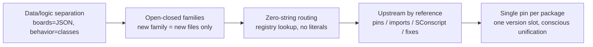
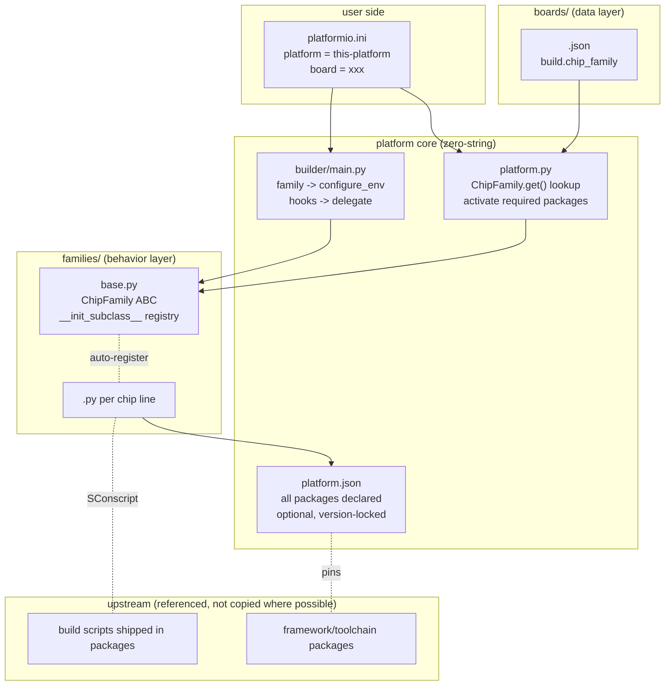
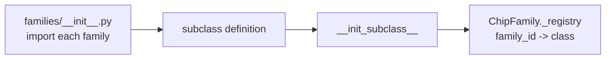
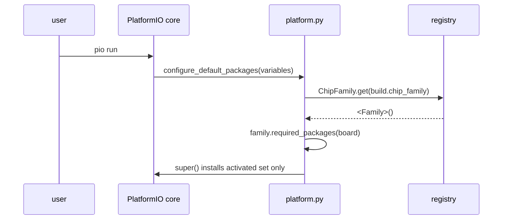
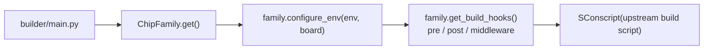
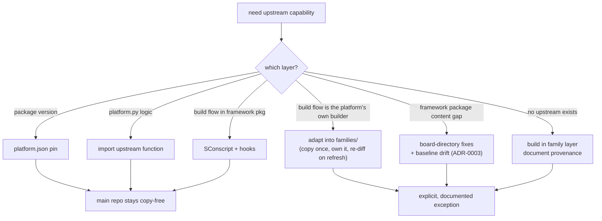

# Architecture — multi-chip unified platform

> This document is the implementation handbook. It amends the original
> design proposal with four constraints proven during the predecessor's
> production work (single-slot packages, the reuse-ladder exceptions,
> the fixes mechanism, and validation tiers) — each amendment cites its
> ADR. Code lands only after its section here is settled.

## 1. Goal and principles

One `platform =` address in `platformio.ini`; switching `board` switches
the chip family. Five binding principles (AGENTS.md restates them):



## 2. Overall structure



Directory layout:

```
families/base.py            # ChipFamily ABC + registry (ADR-0001)
families/<family>.py        # one per chip line
boards/<board>.json         # build.chip_family is the routing key
builder/main.py             # thin entry (ADR-0001)
zephyr/boards/arm/<b>/fixes/  # framework-package fixes (ADR-0003)
scripts/ci/verify_*.py      # offline gates (ADR-0004 T0)
tests/                      # pytest suites for every gate rule
docs/decisions/             # ADRs — the design's source of truth
```

## 3. Core flows

### 3.1 Family auto-registration



New family = one module + one import line. No core file changes.

### 3.2 Build request -> package activation



`required_packages` returns names AND optional version overrides
(ADR-0002): the Adafruit-core family narrows the toolchain to the GCC 7
line with evidence in a comment; the platform.json range declares all
valid lines.

### 3.3 Builder entry, hooks, delegation



### 3.4 The ChipFamily interface (ADR-0001)

```python
class ChipFamily(ABC):
    family_ids: tuple[str, ...]
    # abstract contract
    def required_packages(self, board, variables=None) -> dict[str, object]
    def build_flags(self, board) -> list[str]
    def upload_protocol(self, board) -> str
    def inject_debug_tools(self, board) -> None
    def configure_debug_session(self, debug_config) -> None
    def build_script(self, env, board) -> str
    # optional extension points
    def arduino_script(self, env, board) -> str
    def zephyr_script(self, env, board) -> str
    def get_build_hooks(self) -> list[dict]
    def configure_env(self, env, board) -> None
    def post_activate_packages(self, platform) -> bool
```

`upload_protocol()` is the family fallback for a board manifest that omits
`upload.protocol`; a board/project setting always wins. Upload **action
construction** (commands, signing, touch sequences) lives in the family
build script or hooks — a protocol string is never the whole story.
`build_flags()` is consumed by the families that need it (ESP/SAMD); other
families derive flags in their build script.

## 4. Upstream reuse ladder (ADR-0004)



## 5. Fixes mechanism (ADR-0003, ADR-0006)

`zephyr/boards/arm/<board>/fixes/` — directory IS the registration;
`.patch` = diff, plain file = override with provenance header;
`fixes.baseline` = pristine upstream sha256 per target (always cut
against VANILLA content). Upgrades: bump pin → expect drift →
re-evaluate (upstreamed dies, needed refreshes) → re-cut baselines →
full matrix.

Fixes are applied to a per-build **hardlink framework view** (ADR-0006),
never to the installed package: fixed inputs create a new view, later
builds reuse it, and every write is atomic so the package stays pristine.

## 6. Validation tiers (ADR-0004)

| Tier | When | What |
| --- | --- | --- |
| T0 offline | every commit | pytest + verify gates + boards smoke + grep gates |
| T1 build | behavior changes | affected boards, local-checkout override, clean, fresh cache |
| T2 matrix | milestones / pin changes | one board per consuming family |
| T3 hardware | deliberate only | device evidence or "not performed" |

## 7. Adding a family (standard flow)

1. Scout upstream: package set, meta-logic, build scripts, board
   templates; classify each capability on the reuse ladder.
2. Merge package declarations into platform.json — resolve EVERY name
   collision consciously (ADR-0002), all optional, versions locked.
3. Write `families/<family>.py` (six methods); add the import line.
4. Add `boards/<board>.json` with `build.chip_family`.
5. Validate: T0 gates (including the zero-string grep), T1 build, and
   — before first merge — T2 with at least one board building.

## 8. Risk control

Upstream releases never auto-apply (pins are locked). An upgrade is a
branch: re-validate the affected families at T2, expect fixes drift if
framework packages moved, roll the pin back on failure.
